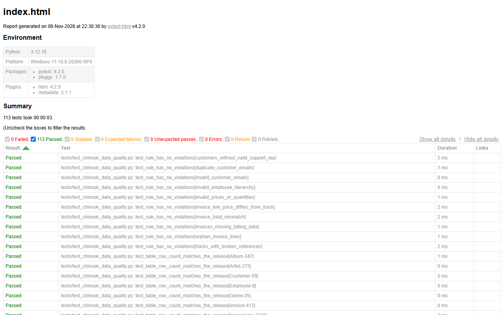

# SQL Database Testing

SQL and pytest for data testing: a library of 40 commented queries a tester uses every week, 22 data-quality
rules, 12 intentionally seeded data defects that the tests must catch, and an ETL validation example — on the
Chinook sample database and a small e-commerce schema in SQLite.

[](https://github.com/the-sudipta/sql-database-testing/actions/workflows/sql-tests.yml)
[](https://the-sudipta.github.io/sql-database-testing/)
[](LICENSE)

## What this project shows

- I write the SQL a tester needs: filters, joins (inner, left, self), GROUP BY/HAVING, subqueries, CTEs and
  window functions — each query explained in a comment ([sql/queries](sql/queries)).
- I turn business rules into **data-quality checks** (duplicates, orphans, referential integrity, totals
  reconciliation, date logic, allowed values) that return exactly the rows that break the rule.
- I **prove the checks work**: 12 defects are seeded on purpose and every one is found by its check, while the
  clean data passes ([report](reports/data-quality-report.md)).
- I validate an **ETL load** from CSV: row counts, checksums, transformation rules, rejects and idempotent reloads.
- Everything runs as a pytest suite in CI with an HTML report.

## Systems under test

| Database | What it is | Used for |
|---|---|---|
| Chinook (SQLite, v1.4.5) | Public sample database of a digital music store: 11 tables, 412 invoices, 3,503 tracks | Query library 01–34, 10 integrity checks |
| Shop (`sql/schema`) | My small e-commerce schema: customers, products, orders, order lines, payments | Business rules, seeded defects, queries 35–40 |
| ETL target | `stg_customers` + `etl_rejects`, loaded from `data/etl/customers_export.csv` | ETL validation |

Chinook comes from [lerocha/chinook-database](https://github.com/lerocha/chinook-database); it is downloaded and
checked against a pinned SHA-256 by `scripts/download_chinook.py` instead of being committed. All people and
contact details in the shop and ETL data are fake.

## Tech stack

SQLite · Python 3.12 (managed by uv) · pytest · pytest-html · ruff · GitHub Actions + Pages

## Project structure

```
sql-database-testing/
├─ sql/
│  ├─ queries/        # 40 numbered, commented queries (01-34 Chinook, 35-40 shop)
│  ├─ checks/chinook/ # 10 rules: each returns the violating rows
│  ├─ checks/shop/    # 12 business rules
│  ├─ schema/         # shop_schema.sql, shop_seed.sql (clean data)
│  └─ defects/defects.sql   # D-01..D-12, each names the check that must find it
├─ qa_db/             # databases.py (open/build DBs), sql_files.py (run .sql), etl.py (CSV -> table)
├─ data/etl/customers_export.csv
├─ tests/             # chinook, shop + defects, query library, ETL
├─ scripts/           # download_chinook.py, data_quality_report.py, setup.ps1 / setup.sh
├─ reports/data-quality-report.md
└─ docs/              # SQL cheat sheet for testers, 30 interview questions
```

## How to run

**Windows (PowerShell)**
```powershell
powershell -ExecutionPolicy Bypass -File scripts\setup.ps1   # uv (if missing), Python 3.12, packages, Chinook
uv run pytest                          # all 113 tests
uv run pytest -m defects -v            # only "seeded defect is detected"
uv run pytest -m etl                   # only the ETL validation
uv run python scripts/data_quality_report.py
```
To try a query by hand, open `data/chinook/Chinook_Sqlite.sqlite` in DB Browser for SQLite or DBeaver and paste
a file from `sql/queries`.

**CI:** `.github/workflows/sql-tests.yml` runs ruff, downloads and verifies Chinook, runs pytest with an HTML and
JUnit report, builds the data-quality report and publishes the reports to GitHub Pages — on push and nightly.

## Test coverage summary

| Area | Tests |
|---|---|
| Chinook: 10 integrity rules, row counts of 11 tables, 4 primary keys, required fields | 26 |
| Shop: 12 rules pass on clean data | 12 |
| Shop: 12 seeded defects detected with exactly the expected keys (+ check list and FK pragma) | 14 |
| Query library: 40 queries run, documented, key answers asserted | 51 |
| ETL: counts, rejects, checksum, 5 transformation samples, duplicates, idempotency | 10 |
| **Total** | **113 passed** |

## Seeded defects and how they are caught

| ID | Defect | Caught by |
|---|---|---|
| D-01 | Order total 1500, lines add up to 1450 | `order_total_mismatch` |
| D-02 | Order line for order 9999 (does not exist) | `orphan_order_items` |
| D-03 | Order for customer 999 (does not exist) | `orders_without_customer` |
| D-04 | `Rahim.Uddin@Example.com` registered twice (case differs) | `duplicate_customer_emails` |
| D-05 | Customer without e-mail | `missing_customer_email` |
| D-06 | Order lines with quantity 0 and price -100 | `invalid_order_lines` |
| D-07 | Delivered order paid 900 of 1000 | `payment_mismatch` |
| D-08 | Shipped 5 days before it was ordered | `shipped_before_ordered` |
| D-09 | Status "shiped" | `invalid_order_status` |
| D-10 | Order dated 2099-01-01 | `future_order_date` |
| D-11 | Stock -5 | `negative_stock` |
| D-12 | Shipped order without a shipped date | `shipped_without_date` |

Full results: [reports/data-quality-report.md](reports/data-quality-report.md).

## Reports

Live HTML report: https://the-sudipta.github.io/sql-database-testing/



## Docs

- [SQL cheat sheet for testers](docs/sql-cheatsheet-for-testers.md)
- [30 SQL interview questions with answers](docs/interview-sql-questions.md)

## Design decisions and what I would do next

- **Checks as SQL files, tests in Python.** The rules stay readable SQL that a DBA can review; pytest only runs
  them and compares results.
- **Every check is proven with a seeded defect**, isolated so it trips exactly one rule.
- **Money in integer cents/taka** to avoid floating-point false alarms.
- Next: run the same checks against PostgreSQL in a CI service container and add schema-migration tests.

## Author

**Sudipta Kumar Das** — Junior SQA Engineer (manual, API, automation) · [GitHub](https://github.com/the-sudipta)

Copyright © 2026 Sudipta Kumar Das. All rights reserved — see [LICENSE](LICENSE).
